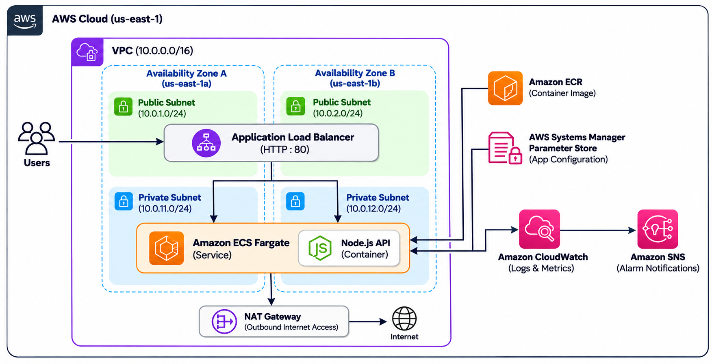
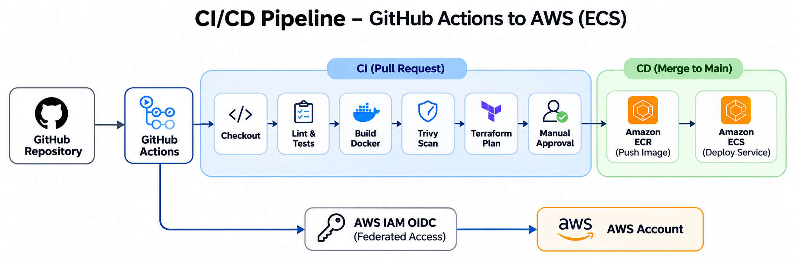

# DevOps Assignment – AWS ECS Fargate Deployment

## 1. Project Overview

This project demonstrates the deployment of a containerized Node.js REST API on AWS using Terraform and GitHub Actions.

The application runs on Amazon ECS Fargate inside private subnets and is accessible through a public Application Load Balancer.

The project covers:

- Application containerization using Docker.
- Infrastructure provisioning using Terraform.
- Automated CI/CD using GitHub Actions.
- Secure AWS authentication using OIDC.
- Application configuration using SSM Parameter Store.
- Centralized logging, monitoring and alerting.
- Remote Terraform state management.

---

## 2. Infrastructure Architecture



The infrastructure is deployed in the AWS `us-east-1` region and consists of:

- A VPC with two public and two private subnets across two Availability Zones.
- A public Application Load Balancer that forwards requests to ECS tasks.
- ECS Fargate tasks running inside private subnets without public IP addresses.
- A NAT Gateway providing outbound internet connectivity.
- Amazon ECR for storing Docker images.
- SSM Parameter Store for application configuration.
- CloudWatch for logging, monitoring and alarms.
- SNS for alarm notifications.
- S3 for Terraform remote state management.

---

## 3. Technologies and Services Used

### Development and DevOps Tools

| Technology | Purpose |
|---|---|
| Node.js 22 | Application runtime |
| Express.js | REST API framework |
| Docker | Application containerization |
| Terraform | Infrastructure as Code |
| GitHub Actions | CI/CD automation |
| ESLint | Code linting |
| Node.js Test Runner and Supertest | Application testing |
| Trivy | Container vulnerability scanning |

### AWS Services

| AWS Service | Purpose |
|---|---|
| Amazon VPC | Isolated network infrastructure |
| Public and Private Subnets | Network segmentation |
| Internet Gateway | Public internet connectivity |
| NAT Gateway | Outbound access for private subnets |
| Elastic IP | Public IP for the NAT Gateway |
| Security Groups | Network access control |
| Application Load Balancer | Application traffic distribution |
| Amazon ECS Fargate | Container hosting |
| Amazon ECR | Docker image storage |
| AWS IAM | Authentication and authorization |
| SSM Parameter Store | Application configuration |
| Amazon S3 | Terraform remote state and locking |
| Amazon CloudWatch | Logging, monitoring and alarms |
| Amazon SNS | Alarm notifications |
| Application Auto Scaling | CPU-based ECS task scaling |

---

## 4. Repository Structure

```text
DevOps-Assignment/
├── .github/
│   └── workflows/
│       ├── ci.yml
│       └── cd.yml
├── app/
│   ├── app.js
│   ├── server.js
│   ├── app.test.js
│   ├── package.json
│   ├── package-lock.json
│   ├── Dockerfile
│   └── .dockerignore
├── terraform/
├── oidc-bootstrap/
├── docs/
│   ├── architecture.png
│   └── cicd-pipeline.png
├── .gitignore
└── README.md
```

The Terraform configuration is divided into two independent components:

- `terraform/` — Manages the application infrastructure.
- `oidc-bootstrap/` — Manages the GitHub OIDC provider and IAM roles.

This separation allows the application infrastructure to be destroyed and recreated without removing the authentication resources required by GitHub Actions.

---

## 5. Application

The application is a lightweight REST API developed using Node.js and Express.

### API Endpoints

| Method | Endpoint | Description |
|---|---|---|
| GET | `/health` | Returns application health status |
| GET | `/items` | Returns application items and configuration message |

The application listens on port `3000`.

The configuration message is stored in AWS SSM Parameter Store and injected into the container at runtime using the ECS task execution role.

### Docker Configuration

The Dockerfile implements the following practices:

- Multi-stage Docker build.
- Lightweight Node.js Alpine base image.
- Production dependencies only.
- Non-root container user.
- Removal of unnecessary package management tools from the runtime image.

---

## 6. Running the Application Locally

### Prerequisites

- Git
- Node.js 22
- Docker

### Clone the Repository

```bash
git clone https://github.com/codeisgoo/DevOps-Assignment.git
cd DevOps-Assignment
```

### Run Using Node.js

```bash
cd app

npm ci
npm run lint
npm test

APP_MESSAGE="Local development" node server.js
```

### Run Using Docker

From the repository root:

```bash
docker build -t devops-assignment-api:local ./app
```

Start the container:

```bash
docker run --rm \
  -p 3000:3000 \
  -e APP_MESSAGE="Local development" \
  devops-assignment-api:local
```

### Test the Application

Open a separate terminal and run:

```bash
curl http://localhost:3000/health
curl http://localhost:3000/items
```

Both endpoints should return successful JSON responses.

---

## 7. AWS Infrastructure Setup

### Prerequisites

- AWS account with appropriate permissions.
- AWS CLI configured locally.
- Terraform 1.12.2.
- GitHub repository.
- GitHub CLI for retrieving repository IDs.
- S3 bucket for Terraform remote state.

### Step 1: Configure Terraform Remote State

Create an S3 bucket in AWS before provisioning the infrastructure.

Update the S3 bucket name in the backend configurations and bootstrap variables.

The project uses two separate Terraform state files:

| Configuration | State Key |
|---|---|
| Application Infrastructure | `devops-assignment/terraform.tfstate` |
| OIDC Bootstrap | `devops-assignment/oidc-bootstrap.tfstate` |

The backend configuration uses:

- S3 remote state storage.
- Server-side encryption.
- Native S3 state locking using `use_lockfile = true`.

Remote state allows both local Terraform commands and GitHub Actions to manage the same infrastructure.

S3 bucket versioning and blocking public access are recommended to protect Terraform state.

### Step 2: Bootstrap GitHub OIDC

The OIDC provider and IAM roles must be created before running the GitHub Actions workflows.

Update the required values in `oidc-bootstrap/terraform.tfvars`, including the GitHub repository details, repository IDs and S3 bucket information.

The GitHub repository and owner IDs can be retrieved using:

```bash
gh api repos/OWNER/REPOSITORY \
  --jq '{repository_id: .id, repository_owner_id: .owner.id}'
```

From the repository root:

```bash
cd oidc-bootstrap

terraform init
terraform validate
terraform plan
terraform apply
```

Retrieve the IAM role ARNs:

```bash
terraform output
```

This step is performed locally because GitHub Actions requires the OIDC provider and IAM roles before it can authenticate with AWS.

### Step 3: Configure GitHub Repository Variables

Navigate to:

**Settings > Secrets and variables > Actions > Variables**

Create the following repository variables using the IAM role ARNs generated by Terraform:

| Variable | Purpose |
|---|---|
| `AWS_CI_ROLE_ARN` | Terraform Plan authentication |
| `AWS_INFRA_ROLE_ARN` | Terraform Apply authentication |
| `AWS_DEPLOY_ROLE_ARN` | ECR and ECS deployment authentication |

No long-lived AWS access keys are required in GitHub.

### Step 4: Configure GitHub Environments

Navigate to:

**Settings > Environments**

Create the following environments:

| Environment | Purpose |
|---|---|
| `ci-plan` | Terraform Plan authentication |
| `infra-apply` | Terraform Apply authentication and manual approval |

Configure required reviewers for the `infra-apply` environment so infrastructure changes require manual approval.

Restrict access to AWS-backed planning and infrastructure deployment to trusted contributors.

### Step 5: Provision Application Infrastructure

Update the required values in `terraform/terraform.tfvars`.

The application infrastructure can be provisioned through GitHub Actions by approving the Terraform Apply job.

Alternatively, it can be provisioned locally from the repository root:

```bash
cd terraform

terraform init
terraform validate
terraform plan
terraform apply
```

For the initial infrastructure deployment, the ECS service can be configured with zero desired tasks until the application image is available in ECR.

The CD pipeline starts the application after pushing the Docker image.

During initial provisioning, the autoscaling minimum capacity should not force ECS to start containers before the image is available. Once the application is deployed, a minimum capacity of one keeps the application available.

---

## 8. CI/CD Pipeline



The project uses two separate GitHub Actions workflows for Continuous Integration and Continuous Deployment.

### Continuous Integration (CI)

**Workflow:** `.github/workflows/ci.yml`

The CI pipeline is triggered when a pull request is created or updated against the `main` branch.

The pipeline performs the following steps:

1. Checkout the repository.
2. Install Node.js dependencies.
3. Run ESLint.
4. Execute application tests.
5. Build the Docker image.
6. Scan the Docker image using Trivy.
7. Authenticate with AWS using OIDC.
8. Initialize and validate Terraform.
9. Generate a Terraform Plan.
10. Request manual approval.
11. Apply the approved Terraform Plan.

Terraform Plan runs only after the application checks succeed.

Trivy scans the Docker image for high and critical vulnerabilities according to the configured scan policy.

Terraform Apply uses the saved Terraform Plan to apply the reviewed infrastructure changes.

AWS-backed Terraform planning is restricted to trusted same-repository pull requests.

For this assignment, manual approval-based infrastructure provisioning is supported through trusted pull requests. In production, Terraform Apply would normally be restricted to approved changes on the main branch.

### Continuous Deployment (CD)

**Workflow:** `.github/workflows/cd.yml`

The CD pipeline runs when changes are merged into the `main` branch.

The pipeline performs the following steps:

1. Checkout the repository.
2. Authenticate with AWS using OIDC.
3. Log in to Amazon ECR.
4. Build the Docker image.
5. Tag the image using the Git commit SHA.
6. Push the Docker image to ECR.
7. Retrieve the current ECS task definition.
8. Register a new task definition revision.
9. Update the ECS service.
10. Wait for the ECS service to stabilize.
11. Verify that the expected task definition is active.

If the ECS service has zero desired tasks, the deployment pipeline sets the desired count to one.

Images are tagged using the Git commit SHA to provide deployment traceability and support rollback to previous application versions.

---

## 9. Accessing the Deployed Application

After the infrastructure and application deployment are complete, retrieve the Application Load Balancer URL.

From the repository root:

```bash
cd terraform

terraform init
terraform output -raw api_url
```

Test both API endpoints:

```bash
API_URL=$(terraform output -raw api_url)

curl -i "$API_URL/health"
curl -i "$API_URL/items"
```

Both endpoints should return HTTP 200 responses.

The application can also be accessed directly through a web browser using the ALB URL followed by `/health` or `/items`.

Additional deployment verification can be performed through:

- ECS service running task count.
- ALB target group health.
- CloudWatch application logs.
- GitHub Actions deployment status.

---

## 10. Security and IAM

The project implements the following security practices:

- ECS tasks run inside private subnets.
- ECS tasks do not have public IP addresses.
- ECS security groups allow application traffic only from the ALB security group.
- Containers run as a non-root user.
- Docker images are scanned for vulnerabilities.
- Application configuration is retrieved from SSM Parameter Store.
- GitHub Actions uses temporary AWS credentials through OIDC.
- Terraform state is stored remotely with encryption and locking.
- Infrastructure changes require manual approval.
- No permanent AWS credentials are stored in the repository.

### IAM Role Separation

Separate IAM roles are used to restrict permissions according to their responsibilities.

| IAM Role | Responsibility |
|---|---|
| ECS Execution Role | Pull images from ECR, retrieve SSM parameters and publish CloudWatch logs |
| ECS Task Role | Application-level AWS permissions |
| GitHub CI Role | Read infrastructure and generate Terraform Plans |
| GitHub Infrastructure Role | Provision and manage application infrastructure |
| GitHub Deployment Role | Push images to ECR and deploy ECS task definitions |

The ECS task role does not require additional permissions because the application does not directly communicate with AWS APIs.

The ECS execution role retrieves the required configuration from Parameter Store and injects it into the container.

The infrastructure provisioning role requires broader permissions to manage AWS resources. In a production environment, these permissions would be further restricted using resource-level IAM policies and permission boundaries.

---

## 11. Monitoring and Alerting

### CloudWatch Logging

ECS container logs are sent to the following CloudWatch log group:

```text
/ecs/devops-assignment
```

The log retention period is configured to seven days.

### CloudWatch Alarm

A CloudWatch alarm monitors HTTP 5xx errors generated by the Application Load Balancer.

When the configured threshold is exceeded, CloudWatch publishes an alarm notification to an SNS topic.

Email notifications can be enabled by configuring and confirming an SNS email subscription.

### Application Health Checks

The Application Load Balancer uses the `/health` endpoint to monitor application availability.

ECS can automatically replace unhealthy tasks.

### Auto Scaling

ECS Service Auto Scaling uses CPU utilization to adjust the number of running tasks.

During normal application operation, the minimum capacity should be at least one to prevent the application from scaling down to zero.

---

## 12. Rollback Strategy

The ECS deployment circuit breaker is enabled to detect failed deployments and automatically roll back when a previous successful deployment is available.

Each deployment creates a new ECS task definition revision, and Docker images are tagged using the Git commit SHA.

If a deployment fails, a previous working task definition can be restored manually:

```bash
aws ecs update-service \
  --region us-east-1 \
  --cluster devops-assignment-cluster \
  --service devops-assignment-service \
  --task-definition devops-assignment-api:PREVIOUS_REVISION
```

Replace `PREVIOUS_REVISION` with the last known working revision number.

Wait for the service to stabilize:

```bash
aws ecs wait services-stable \
  --region us-east-1 \
  --cluster devops-assignment-cluster \
  --services devops-assignment-service
```

After rollback:

- Verify that the expected task definition is active.
- Confirm that the required ECS tasks are running.
- Check ALB target group health.
- Test the application endpoints.
- Review CloudWatch logs.

The previous working Docker image must remain available in ECR.

If the initial deployment fails and no healthy revision exists, the application must be corrected and redeployed.

---

## 13. Estimated Monthly AWS Cost

The following is an approximate monthly cost for running the infrastructure continuously in the AWS `us-east-1` region.

### Assumptions

- One ECS Fargate task.
- 0.25 vCPU and 512 MB memory.
- One NAT Gateway.
- One Application Load Balancer.
- Three public IPv4 addresses.
- Approximately 730 running hours per month.
- Low application traffic.

| AWS Service | Estimated Monthly Cost |
|---|---:|
| ECS Fargate | $9.01 |
| Application Load Balancer | $16.43 - $20.00 |
| NAT Gateway | $32.85 |
| Public IPv4 Addresses | $10.95 |
| Amazon ECR | $1.00 |
| CloudWatch Logs and Alarms | $1.00 - $3.00 |
| S3 Remote State | Less than $1.00 |
| SSM Standard Parameter | $0.00 |
| Amazon SNS | Less than $1.00 |
| **Estimated Total** | **$72 - $80 per month** |

These estimates exclude AWS credits, free-tier benefits, taxes and significant data transfer charges.

Actual costs depend on traffic, storage, data processing and the number of running ECS tasks.

The NAT Gateway and Application Load Balancer are the largest contributors to the monthly cost.

For this assignment, the infrastructure is intended to run temporarily for deployment and testing rather than continuously.

**Pricing Reference:** [AWS Pricing Calculator](https://calculator.aws/)

---

## 14. Production Improvements for a Payments Company

For a production payments environment, the following improvements would be recommended:

| Area | Recommended Improvement |
|---|---|
| High Availability | Run multiple ECS tasks across Availability Zones and remove single points of failure |
| Network Security | Implement AWS WAF and stricter network access controls |
| HTTPS | Use AWS Certificate Manager and enforce HTTPS |
| Secrets Management | Use AWS Secrets Manager with automatic rotation where supported |
| Encryption | Encrypt sensitive data at rest and in transit using AWS KMS and TLS |
| Backups | Implement automated database backups, point-in-time recovery and cross-region backup copies |
| Disaster Recovery | Define RTO and RPO targets and regularly test recovery procedures |
| Monitoring | Add dashboards, distributed tracing, latency and error-rate alarms |
| Audit Logging | Enable AWS CloudTrail, AWS Config and centralized audit logging |
| Threat Detection | Enable Amazon GuardDuty and AWS Security Hub |
| Multi-Account Setup | Separate development, staging, production, security and logging accounts using AWS Organizations |
| IAM Security | Implement stricter least-privilege policies and permission boundaries |
| CI/CD Security | Enforce protected branches, mandatory reviews and image signing |
| Compliance | Implement applicable PCI DSS requirements and payment data access controls |
| Cost Management | Configure AWS Budgets, cost alerts and resource tagging |

The current application is stateless and does not use a database.

Database backup and recovery mechanisms would be introduced when persistent payment data is required.

---

## 15. Infrastructure Cleanup

To avoid unnecessary AWS charges, destroy the application infrastructure after testing.

Ensure that no GitHub Actions deployment or Terraform operation is running.

From the repository root:

```bash
cd terraform

terraform init -reconfigure
terraform plan -destroy
terraform destroy
```

If the ECR repository contains images and automatic repository deletion is not enabled, remove the images before destroying the repository.

Verify that the application resources have been removed:

```bash
terraform state list
```

The GitHub OIDC provider and IAM roles remain available because they are managed through a separate Terraform configuration and state file.

This allows the application infrastructure to be recreated without configuring GitHub OIDC again.

To remove the OIDC infrastructure when it is no longer required:

```bash
cd ../oidc-bootstrap

terraform init
terraform destroy
```

The manually created S3 backend bucket is not removed by these commands.

It can be deleted separately after both infrastructure configurations have been destroyed and their state files are no longer required.

---

## 16. AI Tools Used

OpenAI ChatGPT was used as an AI-assisted development tool for:

- Terraform configuration assistance.
- IAM policy configuration and troubleshooting.
- GitHub Actions assistance.
- Documentation preparation.

The infrastructure and pipelines were executed and tested using AWS, Terraform and GitHub Actions.

---

## 17. Conclusion

This project demonstrates an end-to-end DevOps implementation covering application containerization, infrastructure provisioning, automated CI/CD, secure AWS authentication, monitoring, alerting and rollback.

The infrastructure can be recreated using Terraform, while application deployments are automated through GitHub Actions without storing permanent AWS credentials in the repository.
